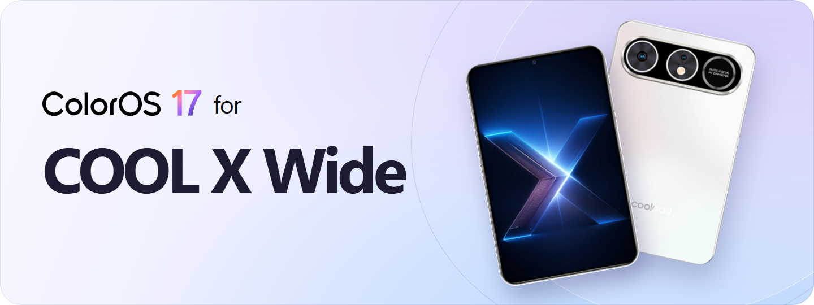

面向酷派阔直板 COOL X Wide（CPDAY11） 的非官方 ColorOS 17 移植。并加入了诸多改善体验的兼容功能。

## 下载

[Releases 下载](https://github.com/Chell64/cpday11-coloros17/releases)

下载全部 7z 分卷和 SHA-256 校验清单。把分卷放在同一目录，从 `.7z.001` 解压。

解压后，您应该得到：

CPDAY11-ColorOS17-17.0.0.xxx-xx-fastboot-windows-x64

刷入 ColorOS V1 前，请将双槽补丁解压到原镜像包目录。A 槽和 B 槽均可开始刷入。 [V1 刷入说明](https://github.com/Chell64/cpday11-coloros17/releases/tag/17.0.0.101-v1)

需要恢复酷派原厂系统时，请使用 FirstAid-V3。 [系统急救包](https://github.com/Chell64/cpday11-coloros17/releases/tag/FirstAid-V3)

## 刷入前

刷机包适用于已解锁的 CPDAY11。刷入完成后会清除用户数据，请先备份。若使用此自制固件，此手机的保修可能会失效。

## 致谢

本项目由先看评测提供支持，感谢先看评测的同事为我提供了这次机会和足够的资源，才使我梦想成真。如果你喜欢这个项目，请关注各平台上的先看评测账号，这会激励我们持续制作更好的内容。

感谢愿意使用项目的你。你们反馈的相关使用问题，帮助我完善了这套移植，也让后续用户能更顺利地刷入。

感谢 OPPO ColorOS 和酷派的开发团队，原厂固件为这次移植和硬件适配提供了基础。也感谢 Android Platform-Tools（ADB、fastboot）、EROFS 工具、payload-dumper-go、PyUSB、libusb 和 7-Zip 的维护者。这些工具帮助我完成了固件提取、镜像打包和便携刷机脚本的制作。

## 许可与署名

本项目有权授权的原创移植代码、补丁和刷机脚本采用 **PolyForm Noncommercial License 1.0.0**。许可允许非商业使用、复制、修改、Fork 和再分发。[许可全文](https://polyformproject.org/licenses/noncommercial/1.0.0)

转载或分发派生版本时，请随附许可全文或链接，并保留下方的项目署名。

```text
Required Notice: COOL X Wide ColorOS 17 移植项目（https://github.com/Chell64/cpday11-coloros17）
```

OPPO、酷派及其他第三方闭源组件的权利归各自权利人所有，使用和分发以各自的授权条款为准。随包分发的第三方开源组件及受其许可约束的改动继续遵循各自原许可。

头图素材来自 [COOL X Wide 商品图](https://www.ithome.com/1/016/160.htm)和 [OPPO ColorOS 17 官方页面](https://www.oppo.com/en/events/oppo-coloros17/)。
